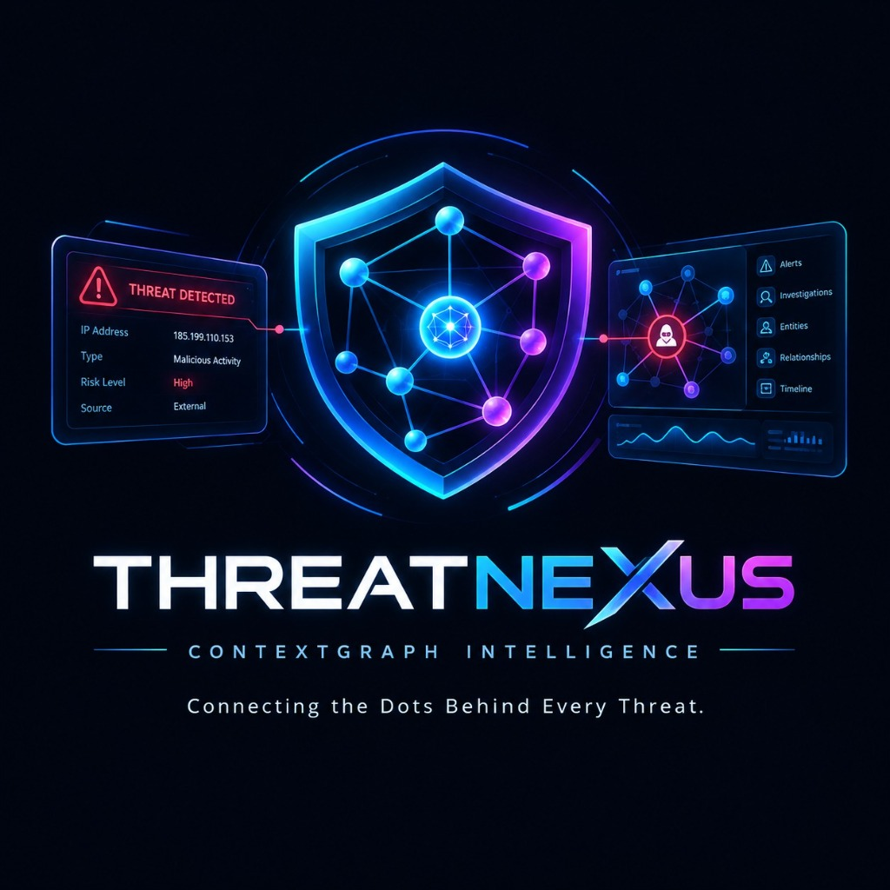
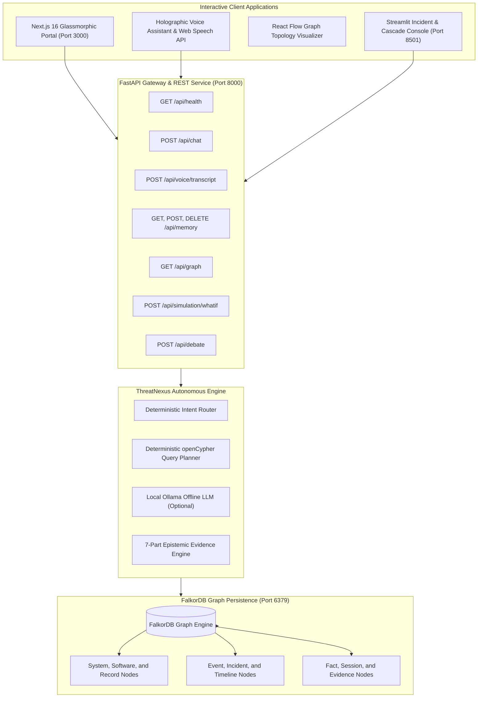

<div align="center">



# ThreatNexus

### Voice-Enabled Persistent AI Agent & Threat Intelligence Platform

**Zero Paid AI APIs · Local-First Graph Memory · Deterministic Grounding · Enterprise Next.js Portal**

<br />

[](https://threat-nexus-three.vercel.app/)
[](tests)
[](https://fastapi.tiangolo.com)
[](https://falkordb.com)
[](frontend)
[](app.py)
[](Dockerfile)
[](LICENSE)

**[🌐 Live Demo](https://threat-nexus-three.vercel.app/)** ·
**[📖 Quickstart](#-quickstart)** ·
**[🏗 Architecture](#-architecture)** ·
**[🔌 API Reference](#-rest-api-reference)** ·
**[☁️ Deployment](#-cloud-deployment)**

</div>

---

## 🌐 Live Demo

Try ThreatNexus without installing anything:

> ### 👉 [**https://threat-nexus-three.vercel.app/**](https://threat-nexus-three.vercel.app/)

Hosted on [Vercel](https://vercel.com). Explore the graph explorer, incident timelines, chaos simulator, and the voice assistant directly in your browser.

---

## 📌 Overview

**ThreatNexus** is an autonomous, voice-enabled cybersecurity and infrastructure intelligence platform powered by **FalkorDB** graph memory. Unlike typical amnesic LLM chatbots that lose context when a conversation ends, ThreatNexus stores entities, software dependencies, cyber incidents, and investigations permanently as a connected knowledge graph.

| | |
|---|---|
| 🧠 **Deterministic Agent Engine** | Runs 100% locally with zero cloud API keys, zero hallucinations and zero cost, using strict openCypher graph traversal. |
| 🦙 **Optional Local LLM** | Offline integration with Ollama (`llama3`, `mistral`), strictly grounded against retrieved graph facts, with automatic deterministic fallback. |
| 💾 **Persistent Graph Memory** | Cross-session memory anchors facts, causal event chains (`AFFECTS`, `LED_TO`) and system topologies in FalkorDB. |
| 🖥 **Cyber Holographic Portal** | Next.js 16 + React 19 + Tailwind CSS with glassmorphic tiles, an interactive React Flow graph explorer, a floating voice assistant and live telemetry. |
| 📊 **Dual Consoles** | Modern Next.js web portal plus a deep-analytics Streamlit SRE dashboard (`app.py`). |

---

## ✨ Key Features

| Capability | Description |
|---|---|
| 🎙 **Voice-Enabled Assistant** | Native in-browser Web Speech API for dictation and spoken responses, with no audio streamed to external servers. |
| 🕸 **FalkorDB Knowledge Graph** | High-performance graph queries mapping systems, software vulnerabilities and incident timelines using native openCypher. |
| 🎯 **Deterministic Intent Classification** | Regex-driven router that classifies queries, checks facts, extracts subgraphs and answers unknown questions honestly. |
| 🔁 **Cross-Session Memory** | Facts recorded in Session A are instantly retrievable in Session B, enabling cumulative investigations. |
| 💥 **Blast Radius Simulator** | Counterfactual what-if chaos simulator (`/api/simulation/whatif`) that computes cascading failures before maintenance. |
| ⚔️ **Adversarial SRE Debate** | Dual-agent simulation that evaluates root-cause hypotheses from competing operational viewpoints. |
| 🚢 **Production Ready** | Pre-configured `Dockerfile` and `docker-compose.yml` for Railway, Docker or bare metal. |

---

## 🏗 Architecture



---

## 🧰 Tech Stack

| Layer | Technology |
|---|---|
| **Frontend** | Next.js 16, React 19, Tailwind CSS, React Flow |
| **Backend** | Python 3.11+, FastAPI, Uvicorn |
| **Database** | FalkorDB (openCypher graph engine) |
| **Analytics Console** | Streamlit |
| **Local LLM (optional)** | Ollama (`llama3`, `mistral`) |
| **Testing** | Pytest |
| **Deployment** | Docker, Docker Compose, Railway, Vercel / Netlify |

---

## 🚀 Quickstart

### Prerequisites

- Python **3.11+**
- Node.js **18+** and npm
- Docker, or WSL 2 with Docker installed

### 1. Clone the repository

```bash
git clone https://github.com/kharedhruva-tech/ai-agent.git
cd ai-agent
pip install -r requirements.txt
```

### 2. Start FalkorDB

```bash
docker run -d --name falkordb -p 6379:6379 -v falkordb_data:/data --restart always falkordb/falkordb:latest
```

Or with Docker Compose:

```bash
docker-compose up -d
```

Verify connectivity:

```bash
python verify_falkordb.py
```

### 3. Seed the knowledge graph

Populate the database with baseline security topologies, software stacks and incident scenarios:

```bash
python seed_data.py
```

### 4. Launch the FastAPI backend

```bash
uvicorn server:app --host 0.0.0.0 --port 8000 --reload
```

| Resource | URL |
|---|---|
| Swagger API Docs | `http://localhost:8000/docs` |
| Health Endpoint | `http://localhost:8000/api/health` |
| Database Telemetry | `http://localhost:8000/api/health/database` |

### 5. Launch the Next.js frontend

In a new terminal:

```bash
cd frontend
npm install
npm run dev
```

Open **http://localhost:3000** to access the command center:

- **Overview & Spatial Workspace**: real-time metrics, system health and interactive holographic tiles.
- **Graph Explorer**: visual graph canvas with dynamic node inspection.
- **Incident Investigation**: cross-session evidence drawer and chronological causal timeline.
- **Scenarios & Chaos Lab**: blast radius simulation for affected microservices.
- **Floating Voice Assistant**: voice-driven threat queries and live memory recall.

### 6. (Optional) Launch the Streamlit SRE console

```bash
streamlit run app.py
```

Available at `http://localhost:8501`.

---

## ☁️ Cloud Deployment

### Backend + FalkorDB on Railway

1. Fork or push this repository to GitHub.
2. In Railway, click **New Project** → provision FalkorDB using the Docker image `falkordb/falkordb:latest`.
3. Click **Add Service** → **GitHub Repo** and select `kharedhruva-tech/ai-agent`.
4. Add the environment variables:

   | Variable | Value |
   |---|---|
   | `FALKORDB_HOST` | Your Railway FalkorDB host |
   | `FALKORDB_PORT` | Your Railway FalkorDB port |
   | `PORT` | `8000` |

5. Railway automatically uses the included `Dockerfile` to build, seed and run `server.py`.

### Frontend on Vercel / Netlify

1. Import the `/frontend` directory.
2. Build command: `npm run build`
3. Output directory: `.next`
4. Environment variable:
   - `NEXT_PUBLIC_API_URL`: `https://your-backend-url.railway.app`

> A copy of the environment template is available in [`.env.example`](.env.example).

---

## 🔌 REST API Reference

| Method | Endpoint | Description |
|---|---|---|
| `GET` | `/api/health` | Service health, version, agent mode and DB status |
| `GET` | `/api/health/database` | Live FalkorDB connectivity, node and edge counts |
| `POST` | `/api/chat` | Main query endpoint (deterministic and local Ollama modes) |
| `POST` | `/api/voice/transcript` | Validates a speech transcript and routes it to the engine |
| `GET` | `/api/memory/search` | Full-text / openCypher search over persistent memory |
| `POST` | `/api/memory` | Creates an atomic Fact node linked to entities or investigations |
| `DELETE` | `/api/memory/{id}` | Deletes a stored Fact or Session record |
| `GET` | `/api/graph` | Full topology for React Flow visualization |
| `GET` | `/api/graph/subgraph` | Bounded n-hop subgraph around a specific entity |
| `GET` | `/api/graph/timeline` | Causal chronological incident timeline |
| `POST` | `/api/simulation/whatif` | Counterfactual blast radius outage simulator |
| `POST` | `/api/debate` | Dual-agent adversarial root-cause debate |

---

## 🗄 FalkorDB openCypher Schema

```cypher
// Node Labels
(:User {id, name, created_at})
(:Conversation {id, title, created_at, updated_at})
(:Message {id, sender, text, agent_mode, timestamp})
(:Fact {id, text, category, provenance, created_at})
(:System {id, name, tier, criticality, status})
(:Software {id, name, version, cve})
(:Event {id, title, severity, timestamp})
(:Session {id, title, status, timestamp})

// Relationships
(:User)-[:HAS_CONVERSATION]->(:Conversation)
(:Conversation)-[:HAS_MESSAGE]->(:Message)
(:Conversation)-[:MENTIONS]->(:System)
(:Event)-[:AFFECTS]->(:System)
(:Event)-[:LED_TO]->(:Event)
(:System)-[:USES]->(:Software)
(:Session)-[:REVISITS]->(:Session)
```

---

## 📁 Project Structure

```
ai-agent/
├── frontend/              # Next.js 16 portal
├── docs/                  # Documentation
├── tests/                 # Pytest suite (47 tests)
├── server.py              # FastAPI entry point
├── api_v1.py              # REST API routes
├── agent.py               # Core agent engine
├── intent_router.py       # Deterministic intent classification
├── chat_service.py        # Chat orchestration
├── memory_service.py      # Persistent cross-session memory
├── graph_service.py       # Graph operations
├── graph_queries.py       # openCypher query library
├── falkordb_bridge.py     # FalkorDB connection layer
├── evidence_service.py    # Epistemic evidence engine
├── simulation_engine.py   # Blast radius simulation
├── whatif_simulator.py    # Counterfactual what-if logic
├── debate_service.py      # Adversarial SRE debate
├── remediation_service.py # Remediation suggestions
├── export_service.py      # Data export
├── webhook_service.py     # Webhook integrations
├── mcp_server.py          # MCP server
├── app.py                 # Streamlit SRE console
├── seed_data.py           # Graph seeding script
├── Dockerfile
└── docker-compose.yml
```

---

## 🧪 Testing

```bash
pytest -v
```

```
============================== 47 passed in 3.78s ==============================
```

- Zero hallucinations guaranteed in deterministic mode.
- Graceful fallback validated when local Ollama is unreachable.
- Cross-conversation fact isolation and memory retrieval tests.
- Cypher injection defense and bounded query enforcement.

---

## 🔒 Security & Privacy

- **No Cloud AI APIs**: all agent processing happens locally and no data leaves your infrastructure.
- **Local Browser Speech**: voice transcription and playback use browser APIs only, with no external audio streaming.
- **Parameterized Cypher**: bounded graph traversals (maximum 3 hops) protect against denial-of-service and graph extraction exploits.
- **Full Data Sovereignty**: complete user control over graph data through explicit memory deletion endpoints.

---

## 🤝 Contributing

Contributions, issues and feature requests are welcome.

1. Fork the repository
2. Create your feature branch: `git checkout -b feature/amazing-feature`
3. Commit your changes: `git commit -m "Add amazing feature"`
4. Push to the branch: `git push origin feature/amazing-feature`
5. Open a Pull Request

---

## 👤 Author

Designed and maintained by **[Dhruva Khare](https://github.com/kharedhruva-tech)**.

## 📄 License

Distributed under the [MIT License](LICENSE).

---

<div align="center">

**⭐ If you find ThreatNexus useful, please consider giving it a star!**

[🌐 Live Demo](https://threat-nexus-three.vercel.app/) · [🐛 Report Bug](https://github.com/kharedhruva-tech/ai-agent/issues) · [💡 Request Feature](https://github.com/kharedhruva-tech/ai-agent/issues)

</div>
