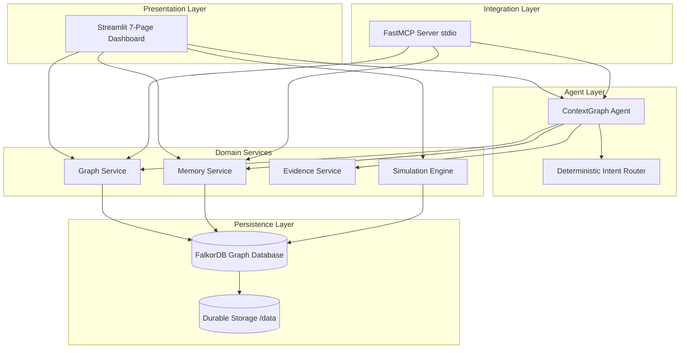

# ContextGraph AI — Persistent, Explainable, Graph-Powered Agent Simulation

**Project Category:** Graph Hacks — Track 1: Agents That Act on Connected Data  
**Primary Language:** Python  
**Primary Graph Database:** FalkorDB  
**Application Framework:** Streamlit  
**Agent Architecture:** Deterministic, Tool-Using Python Agent  
**Integration Standard:** Model Context Protocol (MCP)  
**Testing Framework:** pytest (26 / 26 tests passing)  
**Cost Constraint:** 100% Zero-Cost Operation (No LLM API keys required)

---

## 30-Second Elevator Pitch
> Traditional AI agent memory is session-bound, flat, and amnesic. When a new incident occurs, agents either re-investigate from scratch or hallucinate connections between disconnected records. **ContextGraph AI** changes this by anchoring an agent's memory, tools, and reasoning in **FalkorDB**. Using real openCypher traversals, ContextGraph AI discovers multi-hop dependency chains, persists investigations as graph nodes across restarts, reuses prior session findings with mathematical traceability, and provides a 7-part epistemic explanation for every conclusion—all with zero external LLM API costs.

---

## 1. Problem Statement
Autonomous agents operating in security operations, SRE incident response, and software architecture face fundamental context limitations:
1. **Session Amnesia:** When an agent session ends, discoveries are lost or relegated to unstructured chat logs.
2. **Disconnected Records:** Relational tables and vector databases struggle with multi-hop graph hops (e.g., Event -> System -> Dependency -> Vulnerability).
3. **Repeated Investigations:** An agent examining downstream failure E-102 investigates from scratch, unaware that upstream failure E-101 was already analyzed 20 minutes earlier.
4. **Unexplained Conclusions:** Generic LLM responses offer confidence percentages without citing verifiable graph paths or epistemic rules.

---

## 2. Solution: ContextGraph AI
ContextGraph AI establishes a persistent, explainable graph simulation lab:
- **Real Graph Storage in FalkorDB:** All systems, events, software, sessions, investigations, findings, and evidence are stored as native graph nodes in FalkorDB.
- **Bounded Multi-Hop Cypher Reasoning:** Explores 1-to-3 hop paths connecting incidents to dependencies.
- **Persistent Cross-Session Memory:** Sessions survive full application restarts. When a new session begins, the agent queries FalkorDB for prior relevant context.
- **Context Reuse Engine:** Evaluates reuse eligibility (`REUSED_CONTEXT`, `EXTENDED_INVESTIGATION`, `FRESH_INVESTIGATION`, `CONTRADICTED_PRIOR_FINDING`), linking new sessions to prior ones via `(:Session)-[:REVISITS]->(:Session)`.
- **7-Part Traceable Explainability:** Categorizes facts into `STORED_FACT`, `RULE_BASED_INFERENCE`, `HYPOTHESIS`, and `UNKNOWN`.
- **Model Context Protocol (MCP):** Exposes all domain tools via FastMCP for integration into Claude Desktop or other MCP-compatible clients.
- **Zero API Key Policy:** Operates completely deterministically without OpenAI, Anthropic, or Gemini API keys.

---

## 3. Architecture Overview



---

## 4. Graph Schema & Epistemic Model

### Node Labels (14)
`Person`, `Organization`, `Project`, `System`, `Software`, `Event`, `Record`, `Document`, `Task`, `Session`, `Investigation`, `Finding`, `Evidence`, `Decision`

### Relationship Types (15)
`WORKS_WITH`, `BELONGS_TO`, `OWNS`, `USES`, `DEPENDS_ON`, `AFFECTS`, `RELATED_TO`, `REFERENCED_IN`, `OCCURRED_DURING`, `RECORDED_IN`, `SUPPORTED_BY`, `LED_TO`, `DISCOVERED_IN`, `REVISITS`, `DERIVED_FROM`

### Epistemic Classifications
- **`STORED_FACT`**: Stored directly in FalkorDB records or relationships.
- **`RULE_BASED_INFERENCE`**: Derived deterministically using a documented rule.
- **`HYPOTHESIS`**: Incomplete observation where root-cause telemetry is absent.
- **`UNKNOWN`**: Explicitly unobserved properties.

---

## 5. Prerequisites & Environment
- **Operating System:** Windows, Linux, or macOS.
- **Python:** Python 3.10+ (tested on Python 3.11.9).
- **FalkorDB:** Running locally on port `6379` via Docker or local service.

---

## 6. Installation & Quick Start

### Step 1: Clone Repository & Create Virtual Environment
```bash
git clone https://github.com/your-repo/contextgraph-ai.git
cd contextgraph-ai

# Windows (PowerShell)
python -m venv venv
.\venv\Scripts\Activate.ps1

# Linux / macOS
python3 -m venv venv
source venv/bin/activate
```

### Step 2: Install Dependencies
```bash
pip install -r requirements.txt
```

### Step 3: Launch FalkorDB
Using Docker Compose:
```bash
docker compose up -d
```
*(On Windows environments using WSL2, the container runs in WSL with durable storage mapped to `6379`).*

### Step 4: Seed Synthetic Graph Data
```bash
python seed_data.py
```
*Output: `{'status': 'SEEDED_SUCCESSFULLY', 'nodes': 26, 'edges': 35, 'indices': 11}`*

### Step 5: Launch Streamlit Dashboard
```bash
streamlit run app.py
```
Open your browser at `http://localhost:8501`.

---

## 7. Model Context Protocol (MCP) Server

ContextGraph AI includes a standalone MCP server using the official Python FastMCP SDK.

### Run MCP Server
```bash
python mcp_server.py
```

### Configure in Claude Desktop (`claude_desktop_config.json`)
```json
{
  "mcpServers": {
    "contextgraph": {
      "command": "python",
      "args": ["d:/PROJECT/ai-agent/mcp_server.py"]
    }
  }
}
```

### Exposed MCP Tools
- `search_entities(keyword, limit)`
- `get_entity_details(entity_id)`
- `find_related_records(entity_id, limit)`
- `trace_multi_hop_relationships(start_id, end_id, max_depth, limit)`
- `retrieve_previous_context(target_entity_id, query)`
- `reconstruct_incident_timeline()`
- `run_agent_investigation(user_request)`

---

## 8. Automated Test Suite

Run all unit, integration, and E2E demo tests using `pytest`:

```bash
pytest -v
```

### Verified Test Results:
```text
tests/test_agent.py::test_intent_router_investigate PASSED               [  3%]
tests/test_agent.py::test_intent_router_retrieve_context PASSED          [  7%]
tests/test_agent.py::test_intent_router_timeline PASSED                  [ 11%]
tests/test_agent.py::test_intent_router_ambiguous PASSED                 [ 15%]
tests/test_agent.py::test_agent_investigate_e101_execution PASSED        [ 19%]
tests/test_e2e_demo.py::test_full_e2e_demo_workflow PASSED               [ 23%]
tests/test_evidence.py::test_create_evidence_item PASSED                 [ 26%]
tests/test_evidence.py::test_7_part_explanation_format PASSED            [ 30%]
tests/test_graph_queries.py::test_database_health PASSED                 [ 34%]
tests/test_graph_queries.py::test_search_entities PASSED                 [ 38%]
tests/test_graph_queries.py::test_get_entity_details PASSED              [ 42%]
tests/test_graph_queries.py::test_find_related_records PASSED            [ 46%]
tests/test_graph_queries.py::test_multi_hop_traversal PASSED             [ 50%]
tests/test_graph_queries.py::test_subgraph_extraction PASSED             [ 53%]
tests/test_graph_queries.py::test_incident_timeline PASSED               [ 57%]
tests/test_mcp.py::test_mcp_search_entities PASSED                       [ 61%]
tests/test_mcp.py::test_mcp_get_entity_details PASSED                    [ 65%]
tests/test_mcp.py::test_mcp_trace_multi_hop PASSED                       [ 69%]
tests/test_mcp.py::test_mcp_timeline PASSED                              [ 73%]
tests/test_mcp.py::test_mcp_investigation_agent PASSED                   [ 76%]
tests/test_memory.py::test_save_and_retrieve_session PASSED              [ 80%]
tests/test_memory.py::test_evaluate_context_reuse_not_found PASSED       [ 84%]
tests/test_memory.py::test_evaluate_context_reuse_existing PASSED        [ 88%]
tests/test_simulation.py::test_available_simulation_events PASSED        [ 92%]
tests/test_simulation.py::test_trigger_simulation_event PASSED           [ 96%]
tests/test_simulation.py::test_simulation_activity_log PASSED            [100%]

============================= 26 passed in 0.89s ==============================
```

---

## 9. Required End-to-End Demonstration Walkthrough

Follow the workflow: **"From Fragmented Records to Persistent, Explainable Context"**
See detailed judge script in [`docs/demo_script.md`](docs/demo_script.md).

1. **Step A — Initialize Simulation:** Seed known synthetic systems, records, and events.
2. **Step B — Investigate Event E-101:** Run query. Agent executes Cypher traversals in FalkorDB, establishes multi-hop vulnerability link, formulates findings, and persists session `SESS-XXXX`.
3. **Step C — Verify Persistence:** Open **Memory & Sessions**. The session and its findings exist as permanent graph nodes.
4. **Step D — Investigate Event E-102:** Run query *"What did we discover earlier, and is that information relevant to Event E-102?"*. Agent queries FalkorDB, identifies prior session `SESS-XXXX`, classifies status as `REUSED_CONTEXT` / `EXTENDED_INVESTIGATION`, reuses prior findings, and traces downstream dependency failure `SYS-PAY-02 -> SYS-AUTH-01`.
5. **Step E — Inspect Explainability:** Open **Explainability** to view the 7-part explanation, rule ID, and missing unobserved telemetry.
6. **Step F — Trace Multi-Hop Path:** In **Graph Explorer**, trace `E-101 -> SW-LIBCRYPTO-21` to visualize the exact Cypher path.
7. **Step G — Review Persistent State:** Review the connected web of sessions and investigations in FalkorDB.

---

## 10. Key Differentiators

| Capability | Generic LLM Agent | Vector RAG Agent | ContextGraph AI (Ours) |
| :--- | :--- | :--- | :--- |
| **Primary Context Engine** | Chat Buffer (Session-Bound) | Flat Text Chunks (KNN) | **Native FalkorDB Graph** |
| **Multi-Hop Traversal** | Hallucinated / Prone to drift | Poor (No relational hops) | **Deterministic Cypher Paths** |
| **Cross-Session Memory** | Amnesic after restart | Unstructured document store | **First-class Graph Session Nodes** |
| **Context Reuse Detection**| None (Re-analyzes from scratch)| Chunk similarity match | **Topological & Causal Relevance** |
| **Explainability** | Fabricated confidence % | Quote chunk snippet | **7-Part Epistemic Proof & Rules** |
| **Operating Cost** | Paid token billing | Vector DB + Embedding billing | **100% Free Local Execution** |

---

## 11. Short Demo Video Storyboard (60s)
- **0:00 - 0:10:** Problem hook: Agent memory is broken, flat, and amnesic. Introducing ContextGraph AI.
- **0:10 - 0:25:** Step B: Investigate Event E-101. Show real-time Cypher traversal connecting E-101 to LibCrypto CVE. Show session saved into FalkorDB.
- **0:25 - 0:45:** Step D: Investigate Event E-102. Show FalkorDB retrieving previous session context, displaying the "Reused Context" banner, and proving downstream failure propagation.
- **0:45 - 0:55:** Step E: Show 7-part explainability, distinguishing Stored Facts from Inferences.
- **0:55 - 1:00:** Show 26/26 tests passing and zero-API-key policy badge.

---

## 12. Public GitHub Release-Readiness Checklist
- [x] Zero hardcoded secrets, API keys, or private paths.
- [x] `.env.example`, `.gitignore`, and `requirements.txt` included.
- [x] Real FalkorDB graph persistence verified on live container.
- [x] All 26 pytest unit and integration tests passing.
- [x] MCP server implemented and verified via FastMCP SDK.
- [x] Streamlit 7-page dashboard fully functional.
- [x] Architecture, schema, and demo documentation finalized.
- [x] All claims verified by test executions.

---

## 13. License
Licensed under the Apache 2.0 License. Fictional synthetic data generated exclusively for ContextGraph Simulation Lab.
