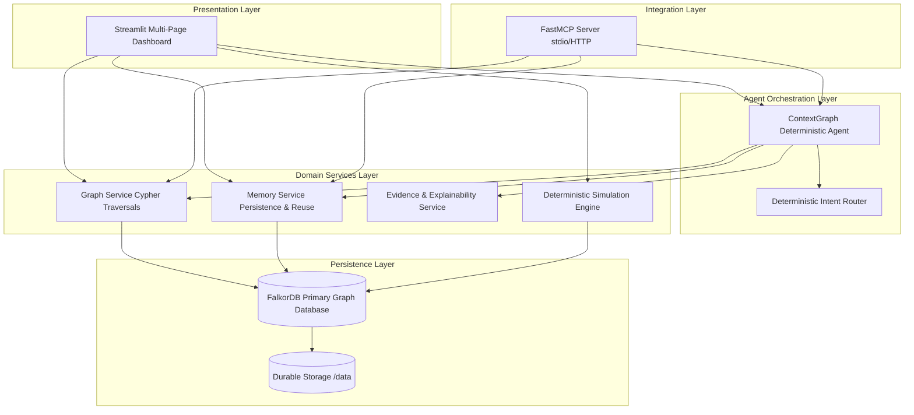

# ContextGraph AI — Architecture & Data Flow

ContextGraph AI is an autonomous, deterministic, graph-powered agent architecture designed for connected data. It operates **100% locally with zero paid LLM API keys**, running on top of **FalkorDB** as its primary graph database.

---

## 1. Layered Architecture Overview

---

## 2. Data Flow Architecture

### A. Intent Routing & Tool Execution
1. The user inputs a natural language query or selects an explicit operation in the Streamlit UI (or sends an MCP tool call).
2. `intent_router.py` applies transparent regex extraction (detecting entity codes such as `E-101`, `SYS-AUTH-01`) and deterministic keyword classifiers.
3. If the request is ambiguous, the router returns candidate intents with confidence `AMBIGUOUS_INTENT`, preventing hallucinated responses.
4. The router dispatches to specialized Python domain tools:
   - `search_entities`
   - `get_entity_details`
   - `find_related_records`
   - `trace_multi_hop_relationships`
   - `evaluate_context_reuse`
   - `get_incident_timeline`

### B. Persistent Memory & Context Reuse Flow
1. Before traversing the graph from scratch, the agent queries `memory_service.evaluate_context_reuse()`.
2. The service queries FalkorDB via Cypher:
   - Has this exact entity or upstream connected causal entity been investigated before?
   - If yes: FalkorDB retrieves the prior session, original findings, and evidence references.
   - The outcome is classified as `REUSED_CONTEXT` or `EXTENDED_INVESTIGATION`.
   - If no prior context exists: `NO_RELEVANT_PRIOR_CONTEXT` or `FRESH_INVESTIGATION`.
3. Newly discovered evidence and prior findings are clearly segregated.
4. When the session finishes, the complete interaction is saved directly into FalkorDB as:
   `(:Session)-[:OWNS]->(:Investigation)-[:DISCOVERED_IN]->(:Finding)-[:SUPPORTED_BY]->(:Evidence)`
   If prior context was reused, an explicit relationship `(:Session)-[:REVISITS]->(:Session)` and `(:Finding)-[:DERIVED_FROM]->(:Finding)` is persisted in the graph.

### C. Grounded Explainability
Every finding must satisfy the 7-part epistemic explanation contract:
1. **Conclusion**: Explicit claim.
2. **Supporting Evidence IDs**: Verified evidence keys.
3. **Graph Paths**: Exact sequences of nodes and edges returned by Cypher.
4. **Applied Epistemic Rule**: Grounded in the documented rule catalog (`RULE-CONNECTED-SOFTWARE-RISK`, `RULE-DOWNSTREAM-DEPENDENCY-PROPAGATION`, etc.).
5. **Contributing Prior Sessions**: Traceable session ID.
6. **Unknowns & Limitations**: What remains unobserved.
7. **Strengthening Evidence Needed**: Required telemetry to convert hypothesis to proven fact.
